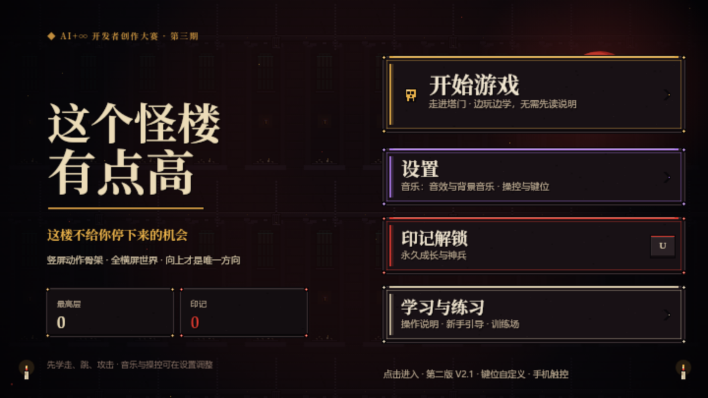

# 这个怪楼有点高 · The Spire Climber (V2.2)

> **版本**：V2.2 横竖屏适配版 ｜ **协议**：[Apache License 2.0](./LICENSE) ｜ **技术栈**：纯原生 HTML5 Canvas（零后端、零构建依赖）  
> AI+∞ 开发者创作大赛第三期「AI 造游戏」参赛作品  
> 这楼不给你停下来的机会：只向上跳，边打边上，脚下持续崩塌。

这是一个纯静态 HTML5 Canvas 动作攀塔游戏。进入塔门厅后选择模式、配置近战与远程武器，在不断崩塌的楼体中向上攀登。

## 在线游玩与部署（GitHub Pages）

本仓库为**纯静态站点**，全部资源均使用相对路径引用，且根目录已内置 [`.nojekyll`](./.nojekyll) 标识文件，可直接部署至 **GitHub Pages**：

1. 将本发布包全部文件推送至你的 GitHub **Public** 仓库根目录（含 `.nojekyll` 与 `assets/`）。
2. 在 GitHub 仓库页面打开 **Settings → Pages**。
3. 在 **Build and deployment → Source** 中选择 **Deploy from a branch**，分支选 `main`、目录选 `/ (root)` 并点击 **Save**。
4. 等待数十秒部署完成后，即可通过 `https://<你的用户名>.github.io/<仓库名>/` 在桌面和手机浏览器中直接游玩。

## V2.2 新增特性：手机横竖屏自适应

- **竖屏持握自动横屏**：手机竖着拿打开链接时，整个游戏舞台自动旋转 90° 铺满屏幕，无需系统自动旋转开关，iframe 嵌套内同样生效（iOS / Android 通用）。
- **方向自动跟随**：读取重力感应判断你把手机转向了哪一侧，画面自动翻面；感应不可用时（权限被拒 / iframe 限制）可用画面底部的「⇄ 换向」按钮手动切换。
- **系统级横屏尽力争取**：首次触摸时尝试 `screen.orientation.lock` 与全屏横屏；被浏览器或 iframe 拒绝时静默回退到旋转方案，不打断游戏。
- **安全区换边**：旋转后刘海 / 圆角安全区自动映射到舞台正确的边，触控键不会被刘海挡住。
- **横屏持握零变化**：手机已经横过来时不旋转、不干预，保持原有全屏布局。
- **门厅触屏入门**：触屏没有 R/F 键——门厅里攻击键变为「进」，走近门按「进」即整备出征；画面底部另有可点按的出征提示（键盘模式的手机同样可点）。
- 桌面窄窗口仍保留竖屏 DOM 菜单；触屏 / 键盘两种操控模式在旋转后均完整可用（键盘模式下仍可用左半屏滑动移动）。

## 设置与音乐

- 主页新增「设置」，可随时打开。
- 「音乐」栏目同时包含 **音效** 与 **背景音乐**，二者独立开关、独立音量并自动保存。
- 手机端提供完整的大按钮设置界面；暂停页也可直接进入音乐和操控设置。
- 键位、音量与操控模式保存在浏览器本地（`localStorage`）。

## 操作与触控

- **桌面默认**：方向键 / `A` / `D` 移动，`Z` / `空格` / `↑` 跳跃，`X` / `J` 攻击，`C` / `K` 下砸，`Shift` 闪避；`Q` 切换近战/远程，`E` 切换同类武器，`P` 画卷，`Esc` 暂停，`H` 操作说明。
- 12 项动作均可自定义键位，保留键和重复键会被明确拒绝。
- **手机触控键**独立于画面缩放，主要按钮约 48–60 CSS 像素，带安全区适配。
- **左侧虚拟摇杆**：原点跟随手指落点，滑动模拟量移动、上推跳跃、空中回中再推二段跳、**空中下推下砸**，一根手指同时完成跑跳；右手只有 **攻击、闪避、切换武器** 三键，不再有多余按键。
- **摇杆大小可调**：设置 → 操控与键位 →「摇杆大小」滑杆（84–176px），带实时预览、即时生效并自动保存；行程与死区等比缩放，手感一致。
- **摇杆原点可选**：「跟随手指（浮动）」= 基座出现在手指落点；「全固定」= 基座固定在左下角，触点相对基座中心取向量。实时切换并自动保存。
- **面板触摸拖拽滚动**：训练工具 / 设置面板在真机旋转画面内用 1:1 指针拖拽滚动（原生触摸滚动在旋转 fixed 容器内不可靠），拖拽后不会误触按钮，滚轮与键盘不受影响。
- **全触屏映射**：门厅「回古城」按钮（=Esc）、暂停页「角色画卷」（=P）、战祭坛靠近后「点此开战」（=F）、暂停键（=Esc）、训练工具面板、难度芯片；下砸 = 摇杆下推（=C/K）。
- 换槽按钮直接显示目标类型「远程 / 近战」；同类武器少于两把时隐藏「同类」按钮。

## 战斗与关卡

- **三种模式**：无尽之塔、沙漏限时、今日怪谈。
- **四档难度**：1 轻松、2 标准、3 困难、4 超级困难。
- 所有难度统一 **每 50 层出现一次 Boss**。
- 六种武器、远征整备、符文、印记成长、黑市与 Boss 讨伐赐福。

## 体验修复

- 战斗 HUD 只保留关键层级；次要信息和通知收敛，减少对角色与落脚点的遮挡。
- 触摸与桌面菜单统一为当前键位提示。
- 平台顶缘、角色轮廓、危险区域与背景层级优化，提升暗色环境下的可读性。
- 攻击、射击、闪避音效不再被环境杂音挤占；烬铁巨剑空挥和命中反馈分离。
- 背景音乐使用分段循环与场景短淡切换；音频加载失败或直接打开本地文件时也有回退路径。
- 运行期偶发脚本异常不再弹出全屏错误框阻断游戏；启动失败仍会明确提示。

## 操作速查

| 操作 | 桌面默认 | 手机触控 |
|---|---|---|
| 左右移动 | `←` / `→` 或 `A` / `D` | 左摇杆滑动 |
| 跳跃 / 二段跳 | `Z` / `空格` / `↑` | 摇杆上推，空中再推 |
| 攻击 | `X` / `J` | 「攻」 |
| 下砸 | `C` / `K` | 摇杆下推（空中） |
| 闪避 | `Shift` | 「闪」 |
| 切换近战 / 远程 | `Q` | 「远程 / 近战」 |
| 切换同类武器 | `E` | 「同类」 |
| 暂停 | `Esc` | 右上「暂停」 |
| 回古城 / 返回标题 | `Esc` | 门厅「回古城」按钮 / 暂停页「舍弃本局」 |
| 角色画卷 | `P` | 暂停页「角色画卷」 |
| 操作说明 | `H` | 竖屏菜单 / 暂停页 |
| 横屏换向 | — | 竖屏持握时底部「⇄ 换向」 |

## 目录说明

- `index.html`：静态入口，位于仓库根目录
- `game.js`：游戏主逻辑
- `assets/`：像素帧动画、特效图与背景音乐等完整资源
- `cover.png`：游戏封面图
- `.nojekyll`：告知 GitHub Pages 跳过 Jekyll 处理，直接托管静态文件
- `.gitignore`：本地系统与编辑器临时文件忽略规则
- `LICENSE`：Apache License 2.0 开源协议
- `README.md`：仓库主页说明文档

## 本地运行说明

1. 本项目为纯静态网页，无需安装依赖或启动后端。
2. 推荐在项目根目录启动任意本地静态 HTTP 服务（例如 `python -m http.server 8080`）后通过浏览器访问。
3. 通过 HTTP / HTTPS 访问时背景音乐使用 WebAudio 分段播放；直接双击本地 `index.html` 时会回退浏览器音频。
4. 手机竖屏持握会自动旋转为横屏画面；转动手机或点「⇄ 换向」可切换持握方向。

## 开源协议

本项目基于 [Apache License 2.0](./LICENSE) 开源。
